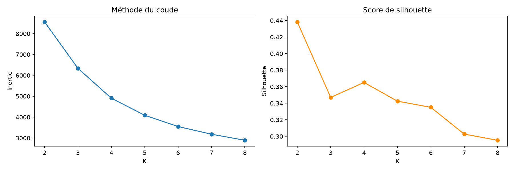
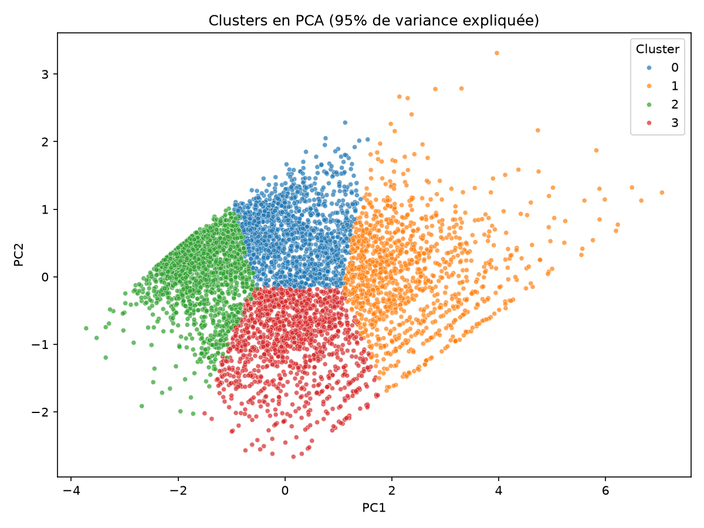
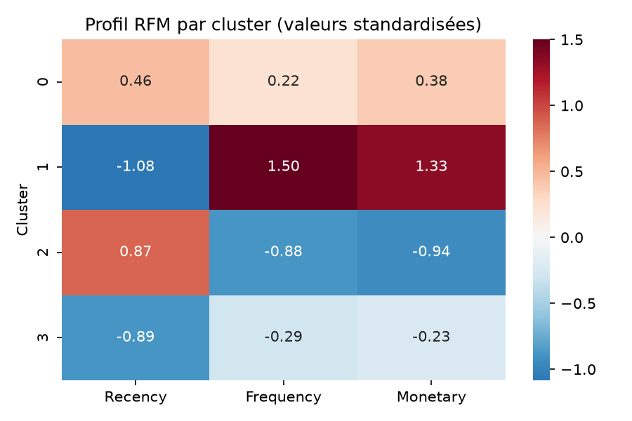
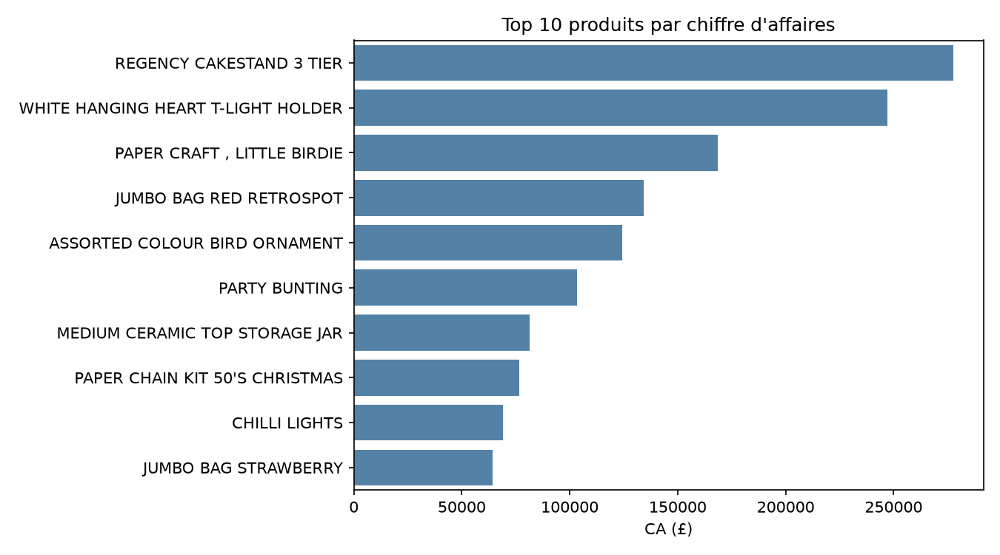

# Segmentation clients et produits rentables (RFM + K-Means)

Analyse des transactions d'un e-commerce de cadeaux pour répondre à deux questions :

1. **Quels types de clients a-t-on ?** (segmentation RFM + K-Means)
2. **Quels produits rapportent le plus, et que préfère acheter chaque segment ?**

## Données

**Online Retail II** (UCI Machine Learning Repository) : transactions d'un e-commerce britannique entre décembre 2009 et décembre 2011.

- Source : https://archive.ics.uci.edu/dataset/502/online+retail+ii
- Également sur Kaggle : « Online Retail II UCI »
- Fichier attendu : `online_retail_II.xlsx` à la racine du projet (non inclus dans le repo à cause de sa taille)

## Méthodologie

1. **Nettoyage** : suppression des lignes sans identifiant client, des retours (factures commençant par `C`), des quantités et prix invalides, des doublons et des lignes qui ne sont pas des produits (frais de port, frais bancaires, ajustements).
2. **Features RFM** par client :
   - *Recency* : jours depuis le dernier achat
   - *Frequency* : nombre de factures distinctes
   - *Monetary* : montant total dépensé
3. **Prétraitement** : transformation `log1p` (distributions très asymétriques) puis standardisation.
4. **Choix de K** : méthode du coude et score de silhouette pour K de 2 à 8.
5. **K-Means** et interprétation des clusters (poids en % des clients et en % du chiffre d'affaires).
6. **Analyse produits** : top produits par chiffre d'affaires, global puis par cluster.

## Résultats

- **Lignes** : 1 067 371 lignes brutes, 776 577 lignes valides après nettoyage
- **Clients analysés** : 5 852
- **K retenu** : 4 (silhouette = 0,365)

**Pourquoi K=4 ?** La silhouette est maximale à K=2 (0,438) mais ce découpage sépare seulement « bons » et « moins bons » clients. K=4 est un pic local de la silhouette (0,365, contre 0,347 à K=3), et la courbe du coude ne montre pas de cassure nette mais une légère inflexion autour de K=4. Il offre des segments distincts et exploitables par le marketing. La silhouette modérée indique des segments qui se touchent (frontières continues plutôt que groupes isolés), ce que confirme la projection PCA (95 % de variance expliquée).

### Segments clients

| Cluster | Profil | Récence (jours) | Fréquence (factures) | Montant moyen / client | % clients | % CA |
|---------|--------|-----------------|----------------------|------------------------|-----------|------|
| 1 | **Champions** : récents, très fréquents, gros montants | 27,6 | 19,2 | 10 590 £ | 20,2 % | 73,3 % |
| 0 | **Clients à risque** : bons clients devenus inactifs | 227,4 | 5,1 | 1 978 £ | 24,9 % | 16,9 % |
| 3 | **Récents à potentiel** : actifs mais peu de commandes | 28,2 | 3,0 | 841 £ | 21,3 % | 6,1 % |
| 2 | **Clients perdus** : un ou deux achats, très anciens | 392,6 | 1,4 | 317 £ | 33,6 % | 3,7 % |

Les noms de segments sont une interprétation des profils RFM, pas une sortie de l'algorithme.

**Constat principal** : 20 % des clients (les Champions) génèrent 73 % du chiffre d'affaires, tandis que le tiers des clients (les perdus) n'en représente que 3,7 %.

### Produits les plus rentables (CA)

| Produit | CA (£) | Unités vendues |
|---------|--------|----------------|
| REGENCY CAKESTAND 3 TIER | 277 656 | 24 124 |
| WHITE HANGING HEART T-LIGHT HOLDER | 247 048 | 91 757 |
| PAPER CRAFT, LITTLE BIRDIE (*) | 168 470 | 80 995 |
| JUMBO BAG RED RETROSPOT | 134 307 | 74 224 |
| ASSORTED COLOUR BIRD ORNAMENT | 124 352 | 78 234 |
| PARTY BUNTING | 103 283 | 23 460 |
| MEDIUM CERAMIC TOP STORAGE JAR (*) | 81 417 | 77 916 |
| PAPER CHAIN KIT 50'S CHRISTMAS | 76 598 | 28 380 |
| CHILLI LIGHTS | 69 084 | 14 843 |
| JUMBO BAG STRAWBERRY | 64 128 | 35 842 |

(*) **À interpréter avec prudence** : ces deux produits ont des volumes très concentrés. Tout le CA de Paper Craft se retrouve dans le cluster 1 et 95 % de celui du Medium Ceramic Top Storage Jar dans le cluster 0. Leurs 80 995 et 77 916 unités correspondent vraisemblablement à une commande géante unique, probablement annulée ensuite. Ces produits sont donc très probablement des artefacts des données (voir Limites).

### Ce que chaque segment achète (top 5 par CA)

| Rang | Cluster 1 (Champions) | Cluster 0 (À risque) | Cluster 3 (Récents) | Cluster 2 (Perdus) |
|------|-----------------------|----------------------|---------------------|--------------------|
| 1 | Regency Cakestand 3 Tier (227 687 £) | Medium Ceramic Top Storage Jar (*) (77 605 £) | Regency Cakestand 3 Tier (9 913 £) | White Hanging Heart T-Light Holder (6 875 £) |
| 2 | White Hanging Heart T-Light Holder (181 622 £) | White Hanging Heart T-Light Holder (50 284 £) | White Hanging Heart T-Light Holder (8 267 £) | Regency Cakestand 3 Tier (6 116 £) |
| 3 | Paper Craft, Little Birdie (*) (168 470 £) | Picnic Basket Wicker 60 Pieces (39 620 £) | Assorted Colour Bird Ornament (7 683 £) | Assorted Colour Bird Ornament (3 421 £) |
| 4 | Jumbo Bag Red Retrospot (115 445 £) | Regency Cakestand 3 Tier (33 941 £) | Paper Chain Kit 50's Christmas (7 273 £) | Party Bunting (3 333 £) |
| 5 | Assorted Colour Bird Ornament (96 308 £) | Party Bunting (19 881 £) | Baking Set 9 Piece Retrospot (5 731 £) | Vintage Union Jack Bunting (3 108 £) |

**Lecture :**
- **Produits socles** : Regency Cakestand, White Hanging Heart T-Light Holder et Assorted Colour Bird Ornament figurent dans presque tous les segments. Ce sont les valeurs sûres de la gamme.
- **Champions** : seuls à porter les Jumbo Bags, produits à gros volume, ce qui est cohérent avec des achats récurrents de revendeurs.
- **Clients à risque** : un profil plus spécifique avec le Picnic Basket Wicker (hors Storage Jar), absent des autres segments.
- **Récents** : du Paper Chain Kit 50's Christmas et du Baking Set. Hypothèse à vérifier : ces clients ont été acquis autour de la saison de Noël.
- **Perdus** : surtout des guirlandes (Party Bunting, Vintage Union Jack Bunting), des produits de décoration à petit prix.

Graphiques (générés dans `figures/`) :






## Recommandations business

- **Champions (cluster 1, 20 % des clients, 73 % du CA)** : priorité absolue à la rétention. Programme de fidélité, remises sur volume, accès anticipé aux nouveautés, et stocks garantis sur les Jumbo Bags et les produits socles.
- **Clients à risque (cluster 0)** : ils ont déjà prouvé leur valeur (5 commandes en moyenne) mais n'ont rien acheté depuis environ 7 mois. C'est le meilleur retour sur investissement pour une campagne de réactivation, ciblée sur leurs produits habituels.
- **Récents à potentiel (cluster 3)** : actifs depuis moins d'un mois mais seulement 3 commandes. Parcours d'accueil, offre sur le deuxième ou troisième achat pour les faire évoluer vers le profil Champion.
- **Clients perdus (cluster 2, 34 % des clients pour 3,7 % du CA)** : peu de valeur par client. Campagne à faible coût (e-mail automatisé) plutôt que des remises coûteuses.
- **Produits socles** (Regency Cakestand, White Hanging Heart T-Light Holder, Assorted Colour Bird Ornament) : à mettre en avant dans toutes les campagnes, quel que soit le segment.

## Limites

- **Silhouette modérée** : K=2 donne un meilleur score (0,438) mais K=4 a été choisi pour son interprétabilité métier. Les segments se chevauchent (visible sur la PCA) : leurs frontières sont indicatives.
- **Valeurs aberrantes** : deux commandes géantes (Paper Craft, Little Birdie : 80 995 unités ; Medium Ceramic Top Storage Jar : 77 916 unités) faussent probablement le classement produits et le profil du cluster 0. Elles ont été volontairement conservées dans cette version pour rester proche des données brutes ; un nettoyage des commandes annulées et des quantités extrêmes serait la prochaine amélioration.
- Une part importante du chiffre d'affaires peut venir de **grossistes** (quelques clients très gros acheteurs), ce qui influence les clusters.
- Le CA est utilisé comme mesure de rentabilité : le dataset ne contient pas les coûts, donc ce n'est pas la marge.
- Le dataset ne couvre que deux ans et un seul pays principal (Royaume-Uni).
- K-Means suppose des clusters sphériques ; d'autres méthodes (GMM, clustering hiérarchique) pourraient être comparées.

## Utilisation

```bash
git clone https://github.com/KenNsana19/Customer-segmentation.git
cd Customer-segmentation
pip install -r requirements.txt
# placer online_retail_II.xlsx à la racine
python rfm_segmentation.py
```

Sorties : graphiques dans `figures/` et `rfm_clusters.csv` (cluster de chaque client).

## Structure du projet

```
.
├── rfm_segmentation.py
├── requirements.txt
├── README.md
├── figures/            # généré par le script
└── rfm_clusters.csv    # généré par le script
```

## Outils

Python, pandas, NumPy, scikit-learn, matplotlib, seaborn.
